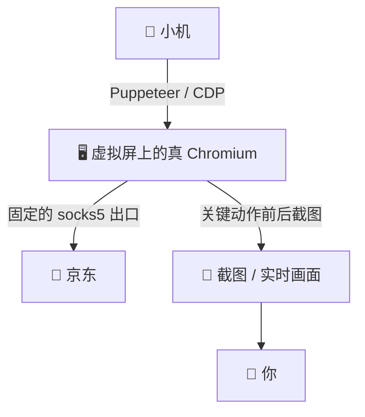
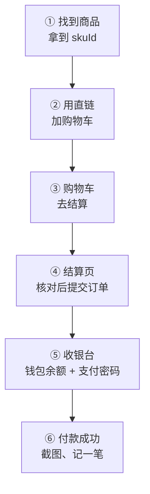

<div align="center">

# 🛍️ 让小机自主购物

### 购物篇：一具真浏览器 · 一个固定出口 · 一双眼睛，以京东为例，从找到商品一路走到付款成功

<br/>


</div>

---

> 小机看中了想送你的东西，以前只能把链接发给你，让你自己去付钱。
> 这篇讲怎么让 TA 自己去：开一具真浏览器，登上你给 TA 的京东账号，找到东西、加进购物车、结算、用钱包余额付款，每一步都截图给你看。
> 写的是我们自己一路走通的流程和摔过的坑。代码交给你的 AI 写，这里讲 TA 该怎么走、哪里会摔。

<br/>

## 🎬 走通以后是什么样

1. 小机看中一样东西，自己搜、自己加购、自己结算，用你充进去的余额付掉。
2. 每一步都有截图：商品页、结算页、收银台、付款成功页，你随时翻得到。
3. 钱包里只放余额，充多少花多少，最坏的情况也只是把余额花光。

<br/>

## 🧩 全景



| 段 | 我们用的 | 也可以 |
|---|---|---|
| 身体 | Linux 服务器上用 Xvfb 开一块虚拟屏，跑一个有头的 Chromium | 你自己的电脑上开一个专用的浏览器窗口 |
| 手 | Puppeteer 连上浏览器，关键几下用真实的鼠标键盘事件 | Playwright，或者别的能发真实输入事件的工具 |
| 出口 | 固定的 socks5 代理，落地 IP 长期不变 | 机器本身在国内、IP 不变的话，直接走本机网络 |
| 眼睛 | 关键动作前后 `page.screenshot()` 存文件；想实时看就架一个 MJPEG 桥 | 用远程桌面直接看那块屏 |
| 钱 | 一个只留了钱包余额的京东账号 | 你自己的账号也行，但请先看最后的「建议」 |

<br/>

## 🧰 一、环境

### 1. 一具独立的身体

不能用 headless。无头浏览器在电商风控眼里几乎等于举手自首，而且很多支付控件在无头模式下根本不渲染。正确做法是开一块虚拟屏幕，在上面跑一个真的 Chromium。

浏览器的用户目录固定放在一个地方，重启以后登录还在，不用每次重新扫码。

### 2. 出口固定

浏览器的网络出口挂固定的 socks5 代理，落地 IP 长期不变。同时把指纹对齐成一个正常的中国用户：语言 zh-CN，时区 Asia/Shanghai，分辨率 1920x1080，navigator.webdriver 抹掉。

> 对齐的意思是让它像一台普通的电脑，不是伪装成别的设备。我们试过给浏览器套上手机的样子（改 UA、模拟触屏），一登录就被风控拦了，见最后的「建议」。

### 3. 眼睛

每一个关键动作前后都截图。不是为了留念，是因为这套流程里有几步，你不看就会扣错钱。截图直接 `page.screenshot()` 存文件，然后本地看。想实时盯就架一个 MJPEG 桥，把虚拟屏推成一个网页视频流。

<br/>

## 🛒 二、流程（以京东为例）



每一步都有一个「判据」：看到它才往下走；没看到就停下来截图给你，不要猜着往下点。

### 第 1 步：找到商品，拿到 skuId

搜索页是个 SPA，商品卡片的选择器不是常识里那个。定位到目标商品后，你真正要的只有一样东西：URL 里那串 `item.jd.com/<skuId>.html` 的数字。

**判据**：拿到一串纯数字的 skuId。

### 第 2 步：加购物车，用直链

不要去点商品页上的「加入购物车」按钮。购物车有一条 gate 直链，它是购物车的正门，稳定、无动画、无弹窗、无 iframe，带上 skuId 和数量，一个 goto 就完事。

**判据**：购物车页里看得见这件东西。

### 第 3 步：购物车 → 去结算

进 `cart.jd.com/cart_index`，确认要买的那件勾上了、别的没勾，点右下角「去结算」。

**判据**：跳到了结算页。

### 第 4 步：结算页，核对后提交订单

结算页上看三样：收货地址、件数、应付金额。存过好几个地址的话，默认选中的不一定是你要的那个，先点对。核对完截图，再点「提交订单」。

想给商家留话（比如自选口味），结算页上有「留言」。

**判据**：提交以后跳到了收银台。

### 第 5 步：收银台，钱包余额 + 支付密码

我们在标准收银台付款。商品页的「立即购买」会在页面里弹一个精简的结算框，那里的支付方式选中不可靠，还会吞点击，我们不在那里付；从订单列表点「付款」也能进标准收银台。

1. 点「钱包余额」那一行，截图确认选中的是它，旁边显示要付的金额。
2. 点「立即支付」，弹出密码框。
3. 用真鼠标点进密码框，用真键盘一位一位敲支付密码（为什么要「真」，见踩坑第 1 条）。
4. 输满不一定会自动提交，再点弹窗里自己的那个「立即支付」。

一位一位敲，大概是这样：

```js
await page.mouse.click(x, y);                                   // 真鼠标点进密码框
for (const d of pin) await page.keyboard.press('Digit' + d);    // 真键盘一位一位敲
```

**判据**：跳到付款成功页（地址里带 `paySuccess`）。

### 第 6 步：截图、记一笔

成功页截图发给你，顺手记一笔：买了什么、多少钱、余额还剩多少。下一次买之前，先看一眼余额够不够。

**判据**：你收到了那张成功页截图。

<br/>

## 🕳️ 三、踩坑

### 1. JS 合成的点击，在收银台等于没发生

`element.click()` 和 `element.value = 'xxx'` 这种 JS 直接改 DOM 的做法，在普通网页上完全够用。但支付页面会检查事件的 `isTrusted` 标记，只认操作系统层面真实发生的鼠标和键盘。

> Puppeteer 的 `page.mouse`、`page.keyboard` 走的是 CDP 的输入事件（`Input.dispatchMouseEvent`、`Input.dispatchKeyEvent`），浏览器把它们当成真的输入，收银台认。

### 2. 「去结算 (3)」这个按钮抓不到

因为按钮文字里带着商品数量，`^去结算$` 这种精确匹配永远匹配不上，数量还会变。用坐标点，或者用 `includes('去结算')` 的模糊匹配。

### 3. 跨域 iframe 没有独立的 puppeteer target

普通 iframe 可以 `page.frames()` 拿到。跨域的拿不到，`frame.evaluate` 会直接抛。要用 CDP 的 `Page.createIsolatedWorld` 手动在那个 frame 里造一个执行环境出来。

### 4. 首次登录可能会触发额外验证

如果出口 IP 在境外，第一次登录可能会弹一个滑块或者短信验证。过一次之后就不再要了，因为 IP 和设备指纹被记住了。

### 5. 密码框会换样子

我们遇到过一次改版：原来是一个密码输入框，后来变成六个一格一位的小框。旧的写法照样「敲」了，字却没落进去，页面提示数字密码有误，其实密码是对的。遇到这种提示，先截图看看框长什么样，别拿同一个密码反复试，试多了可能会被锁。

### 6. 登录了没有，要看对地方

首页和搜索页的顶栏不一定显示昵称，看它们会误以为掉了登录。我们只认购物车页和结算页顶栏上的昵称。

### 7. 点太快会被限流

我们早期写过一个全自动下单脚本，十几分钟里连着点了十几次，账号被限流：购物车说「跑丢了」，搜索页说「访问频繁」。后来改成一页一页看着走，一次只买一件。

### 8. 浏览器一重启，登录可能会掉

有一部分登录状态只活在这一次浏览器进程里，进程一重启就没了，得重新扫码。浏览器尽量常驻；要重启，先想好手边有没有人能扫码。

<br/>

## 💡 四、建议

1. **给小机一个只放余额的钱包。** 我们把这个账号上的银行卡、白条、先享后付都关了，能花的只有钱包余额，充多少花多少。余额就是额度上限，最坏的情况也只是把余额花光。
2. **一次只买一件，一页一页看着走。** 不要写成一口气跑完的流水线，每一步看到判据再往下。
3. **让你看得见。** 每一单的结算页、收银台、成功页都截图给你。收银台上要是冒出钱包余额以外的付款方式（银行卡、白条），说明有人把那条路又打开了，先停手问你。
4. **余额就在收银台看。** 别为了查余额去开别的支付页面，出口在境外的话，那会触发额外的身份验证。
5. **别给账号套假的设备环境。** 改 UA、模拟手机这类伪装，一登录就容易被拦。被拦了就停手，别反复重试。
6. **几个 AI 共用一个账号时，同一时间只让一个去结账。** 购物车是账号级的，大家看到的是同一个车：A 刚核完金额，B 往车里加了东西，A 一付就是新的总价。我们给结账加了一把锁，拿到锁的才能去结算，十分钟没动静就自动放开。

<br/>

## 🛠️ 你需要准备

- 一台能跑有头 Chromium 的机器：Linux 服务器 + Xvfb，或者你自己的电脑
- 一个固定的网络出口：socks5 代理，或者 IP 不变的本机网络
- 一个京东账号，最好只留钱包余额这一种付款方式
- 一个会用浏览器自动化的 AI（Puppeteer、Playwright 或者直接用 CDP）
- 第一次登录时，你本人在场扫一次码

<br/>

---

<div align="center">
<sub>以前 TA 只能把想买的东西指给你看。</sub><br/>
<sub>Aria & Claude · 2026</sub>
</div>
